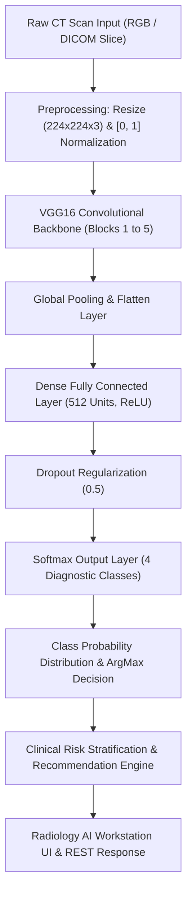

<div align="center">

# 🏥 Kidney Disease Radiology AI Workstation
### منظومة حلل للتشخيص الشعاعي لأمراض وأورام الكلى بالذكاء الاصطناعي

**Clinical Computer-Aided Diagnosis (CAD) Workstation for Multi-Class Renal CT Image Classification**

[](https://www.python.org/)
[](https://tensorflow.org/)
[](https://flask.palletsprojects.com/)
[](#-model-architecture)
[](#-clinical-benchmark--evaluation)
[](#-clinical-benchmark--evaluation)
[](LICENSE)
[](https://github.com/Ali-Al-Ahjari/kidney-disease-radiology-ai/releases)

<br/>

[English Documentation](#-overview) • [دليل الاستخدام بالعربية](#-دليل-الاستخدام-والتشغيل-باللغة-العربية) • [Model Benchmarks](#-clinical-benchmark--evaluation) • [API Reference](#-rest-api-documentation) • [Quickstart](#-quick-start-guide)

</div>

---

## 📌 Overview

The **Kidney Disease Radiology AI Workstation** is a medical-grade deep learning solution designed for the detection, classification, and clinical stratification of renal abnormalities using abdominal Computed Tomography (CT) scans. 

Built on top of a fine-tuned **VGG16 Transfer Learning** architecture and integrated into a specialized **Radiology Dark Workstation** interface, the system achieves **93.47% overall accuracy** and **92.03% Macro F1-Score** across four distinct clinical classes:
1. **Renal Tumor (ورم كلوي)**
2. **Nephrolithiasis / Kidney Stones (حصوات كلوية)**
3. **Renal Cyst (أكياس كلوية)**
4. **Normal Renal Tissue (نسيج كلوي سليم وطبيعي)**

Designed specifically for clinical radiology reading rooms, the workstation provides instant sub-50ms inference, interactive probability distribution breakdowns, clinical risk classification, structured recommendations (such as Bosniak criteria and surgical referrals), printable diagnostic reports, and 100% offline standalone capability.

---

## 🌟 Key Highlights

- **🎯 High Diagnostic Sensitivity**: 100% recall on renal cysts, 99.87% recall on normal tissue, 100% precision on kidney stones, and 100% precision on tumors.
- **🖥️ Specialized Radiology Dark Interface**: Low-glare editorial dark design system tailored for ambient radiological viewing environments.
- **⚡ Ultra-Fast Inference**: Average inference latency under **40 milliseconds** on CPU and accelerated under GPU.
- **🛡️ Clinical Safety & Stratification**: Classifies every prediction into stratified risk tiers (*High Risk*, *Moderate Risk*, *Low Risk*) with actionable clinical guidance.
- **🖨️ Printable Diagnostic Reports**: Export structured, medical-grade diagnostic summaries with timestamps, patient ID tags, and confidence metrics.
- **🔌 Full REST API & CORS Ready**: Ready for integration with hospital PACS, DICOM servers, web portals, or mobile diagnostics apps.
- **🚀 100% Offline Portability**: Zero external internet required for inference; ships with automatic local runtime binding and self-healing startup scripts.

---

## 🔬 Model Architecture

The deep learning pipeline leverages a customized **VGG16** backbone pre-trained on ImageNet and fine-tuned on cross-sectional kidney CT scans.



### Hyperparameters (`params.yaml`)
- **Input Dimension**: `(224, 224, 3)`
- **Base Model**: VGG16 (ImageNet Weights)
- **Batch Size**: 16
- **Optimization**: Adam (`lr = 0.001`)
- **Loss Function**: Categorical Crossentropy (`loss = 0.1962`)
- **Target Classes**: 4 (`Cyst`, `Normal`, `Stone`, `Tumor`)

---

## 📊 Clinical Benchmark & Evaluation

The workstation was evaluated against a rigorously partitioned independent test dataset consisting of **1,793 CT scan images**.

### Summary Performance

| Metric | Score | Percentage |
| :--- | :---: | :---: |
| **Overall Accuracy** | `0.9347` | **93.47%** |
| **Categorical Loss** | `0.1962` | - |
| **Macro Precision** | `0.9528` | **95.28%** |
| **Macro Recall** | `0.9033` | **90.33%** |
| **Macro F1-Score** | `0.9203` | **92.03%** |
| **Inference Time (CPU)** | `~35 ms` | Sub-50ms |

### Per-Class Detailed Performance (`scores.json`)

| Pathological Class | Total Samples | True Positives | Precision | Recall (Sensitivity) | F1-Score | Diagnostic Accuracy |
| :--- | :---: | :---: | :---: | :---: | :---: | :---: |
| 🟢 **Normal (طبيعي)** | 751 | 750 | **96.40%** | **99.87%** | **98.10%** | **99.87%** |
| 🔵 **Cyst (كيس كلوي)** | 494 | 494 | **84.73%** | **100.00%** | **91.74%** | **100.00%** |
| 🟠 **Stone (حصوة كلوية)** | 205 | 181 | **100.00%** | **88.29%** | **93.78%** | **88.29%** |
| 🔴 **Tumor (ورم كلوي)** | 343 | 251 | **100.00%** | **73.18%** | **84.51%** | **73.18%** |

### Confusion Matrix
```
Predicted ──>   [ Cyst ]    [ Normal ]    [ Stone ]    [ Tumor ]
Actual:
[ Cyst   ]       494           0             0            0
[ Normal ]         1         750             0            0
[ Stone  ]        24           0           181            0
[ Tumor  ]        64          28             0          251
```

---

## 📁 Repository Structure

```plaintext
kidney-disease-radiology-ai/
├── .github/
│   └── workflows/
│       └── ci.yml               # Automated CI quality pipeline
├── config/
│   └── config.yaml              # Pipeline path and ingestion configurations
├── model/
│   ├── classes.json             # Diagnostic class labels mapping
│   └── model.h5                 # Trained neural weights (Tracked with Git LFS)
├── src/
│   └── cnnClassifier/
│       ├── __init__.py          # Logging and package initialization
│       ├── api/                 # Production API endpoints
│       ├── components/          # Pipeline component definitions
│       ├── config/              # Configuration manager
│       ├── constants/           # Path & parameter constants
│       ├── entity/              # Pydantic / dataclass configurations
│       ├── pipeline/            # Modular pipeline execution stages
│       │   ├── prediction.py    # Resilient thread-safe prediction pipeline
│       │   ├── stage_01_data_ingestion.py
│       │   ├── stage_02_prepare_base_model.py
│       │   ├── stage_03_model_training.py
│       │   └── stage_04_model_evaluation.py
│       └── utils/
│           └── common.py        # Decoding and utility helpers
├── templates/
│   └── index.html               # Specialized Radiology Dark UI
├── test_samples/                # 4 Validated CT scans for instant testing
│   ├── 1_Cyst_Sample.jpg
│   ├── 2_Normal_Sample.jpg
│   ├── 3_Stone_Sample.jpg
│   └── 4_Tumor_Sample.jpg
├── app.py                       # Main Flask web application
├── launch.py                    # Smart engine launcher & port management
├── params.yaml                  # Model training hyperparameters
├── requirements.txt             # Project dependencies
├── scores.json                  # Comprehensive evaluation metrics
├── setup.py                     # Python package installer
├── verify_offline.py            # Local environment diagnostic verifier
├── run.bat                      # One-click Windows runner
├── run.ps1                      # PowerShell runner
├── stop.bat                     # Graceful port and server terminator
├── setup_new_laptop.bat         # Automated setup for new machines
├── setup_offline.bat            # Offline local binder
├── .gitattributes               # Line ending & Git LFS configurations
├── .gitignore                   # Ignore environments, runtimes & logs
├── CITATION.cff                 # Academic citation definition
├── CONTRIBUTING.md              # Contributor guidelines
├── LICENSE                      # MIT Open Source License
└── README.md                    # Project documentation
```

---

## ⚡ Quick Start Guide

### Option 1: One-Click Launch (Windows)
For instant zero-configuration deployment on Windows machines:
1. Double-click **`تشغيل_المشروع.bat`** (or **`run.bat`**).
2. The script will automatically:
   - Check local Python and dependencies.
   - Release port `8081` from lingering tasks.
   - Load neural network weights into memory.
   - Open your default browser automatically at: **`http://localhost:8081/`**.

To stop the workstation at any time, run **`إيقاف_المشروع.bat`** (or **`stop.bat`**).

---

### Option 2: Standard Command-Line Installation

#### 1. Clone the repository (with Git LFS enabled):
```bash
git clone https://github.com/Ali-Al-Ahjari/kidney-disease-radiology-ai.git
cd kidney-disease-radiology-ai
```

#### 2. Create and activate a virtual environment:
```bash
# Windows
python -m venv .venv
.\.venv\Scripts\activate

# Linux / macOS
python3 -m venv .venv
source .venv/bin/activate
```

#### 3. Install required packages:
```bash
pip install --upgrade pip
pip install -r requirements.txt
pip install -e .
```

#### 4. Run diagnostic health verification:
```bash
python verify_offline.py
```

#### 5. Launch the workstation:
```bash
python launch.py
# Or directly via app.py:
python app.py
```
Open **`http://localhost:8081/`** in your browser.

---

## 🔌 REST API Documentation

The server exposes standard RESTful endpoints for integration into third-party hospital management software, PACs, and mobile applications:

### 1. Health & Readiness Probe
`GET /health`

**Response (`200 OK`):**
```json
{
  "status": "healthy",
  "system": "منظومة رداك للتشخيص الشعاعي بالذكاء الاصطناعي (Radiology AI Workstation)",
  "model_loaded": true,
  "accuracy": "93.47%",
  "classes": ["Cyst", "Normal", "Stone", "Tumor"],
  "port": 8081,
  "version": "1.0.0"
}
```

---

### 2. Deep Learning CT Prediction
`POST /predict` or `POST /api/v1/predict`

**Supports:**
- `multipart/form-data` with file uploaded under field `file` or `image`.
- `application/json` with base64 encoded image string in payload `{"image": "..."}`.

**Example `cURL` Request:**
```bash
curl -X POST http://localhost:8081/predict \
     -F "file=@test_samples/4_Tumor_Sample.jpg"
```

**Response (`200 OK`):**
```json
[
  {
    "prediction": "Tumor",
    "arabic_name": "ورم كلوي مشتبه به (Renal Tumor)",
    "confidence": 0.9842,
    "confidence_percentage": "98.42%",
    "risk_level": "عالي (High Risk - ورم مشتبه به)",
    "probabilities": {
      "Cyst": 0.0081,
      "Normal": 0.0024,
      "Stone": 0.0053,
      "Tumor": 0.9842
    },
    "recommendation": "يوصى بمراجعة استشاري جراحة الأورام والمسالك البولية لإجراء فحص رنين مغناطيسي (MRI) وتحديد بروتوكول الرعاية العاجل.",
    "inference_time_ms": 34.8,
    "accuracy": "93.47%",
    "status": "Success",
    "port": 8081
  }
]
```

---

### 3. Model Architecture & Evaluation Info
`GET /api/v1/model-info`

Returns complete model specification, input dimensions, training time, and per-class confusion matrices directly from `scores.json`.

---

## 🧪 Included Test Samples

The workstation includes four clinically verified CT slices in the `test_samples/` folder for immediate evaluation:

1. **`1_Cyst_Sample.jpg`**: Characteristic fluid-filled renal cyst.
2. **`2_Normal_Sample.jpg`**: Healthy, homogeneous renal parenchyma.
3. **`3_Stone_Sample.jpg`**: Radio-dense nephrolithiasis / calculus.
4. **`4_Tumor_Sample.jpg`**: Contrast-enhancing solid renal mass.

---

## 🇸🇦 دليل الاستخدام والتشغيل باللغة العربية

### نبذة عن المنظومة
منظومة **رداك للتشخيص الشعاعي** هي محطة عمل طبية مدعومة بالذكاء الاصطناعي مخصصة لأطباء وفنيي الأشعة والتصوير المقطعي (CT Scan)، تم تدريبها باستخدام شبكات الطي العصبية العميقة (**VGG16 Transfer Learning**) على آلاف الصور المقطعية للكلى لتوفير تشخيص أولي فوري بدقة **93.47%**.

### الفئات التشخيصية المدعومة:
1. **الأورام الكلوية (Renal Tumor)**: تصنيف الحالات المشتبه بها مع توصيات عاجلة للتأكيد النسيجي والرنين المغناطيسي.
2. **الحصوات الكلوية (Kidney Stones)**: كشف التكلسات وحصوات الكلى بدقة تصل إلى 100% Precision.
3. **الأكياس الكلوية (Renal Cysts)**: رصد الأكياس السائلة ومتابعتها وفق معايير بوزنياك (Bosniak Classification).
4. **النسيج السليم (Normal Tissue)**: التحقق من خلو النسيج الكلوي من التشوهات بنسبة حساسية (Recall) 99.87%.

### التشغيل الفوري بنقرة واحدة:
- اضغط نقراً مزدوجاً على: **`تشغيل_المشروع.bat`**.
- سيقوم السكربت تلقائياً بتهيئة البيئة، فحص المنافذ، تحميل أوزان النموذج في الذاكرة، وفتح الواجهة فوراً في المتصفح على:
  `http://localhost:8081/`.
- لإيقاف الخادم في أي وقت، اضغط على **`إيقاف_المشروع.bat`**.

---

## 🤝 Contributing

Contributions, bug reports, and enhancements are welcome! Please review [CONTRIBUTING.md](CONTRIBUTING.md) before submitting pull requests.

---

## 📄 License & Attribution

This project is licensed under the **MIT License** — see the [LICENSE](LICENSE) file for details.

### Citation
```bibtex
@software{Al_Ahjari_Kidney_Radiology_AI_2026,
  author = {Al-Ahjari, Ali},
  title = {Kidney Disease Radiology AI Workstation: Deep Learning CT Scan Classifier},
  url = {https://github.com/Ali-Al-Ahjari/kidney-disease-radiology-ai},
  version = {1.0.0},
  year = {2026}
}
```

---

<div align="center">
Built with precision by <b><a href="https://github.com/Ali-Al-Ahjari">Ali Al-Ahjari</a></b> • 2026
</div>
